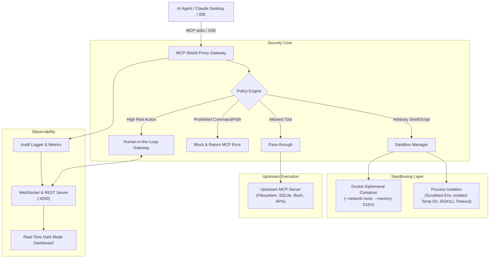

# 🛡️ MCP-Shield

> **Hardened, Sandboxed Security Gateway & Real-Time Observability Proxy for Anthropic's Model Context Protocol (MCP)**

[](https://www.typescriptlang.org/)
[](https://modelcontextprotocol.io/)
[](https://vitest.dev/)
[](https://github.com/)
[](LICENSE)

---

## 🎯 Why Anthropic Cares

Anthropic launched the **[Model Context Protocol (MCP)](https://modelcontextprotocol.io/)** and **Claude 3.5 Computer Use** to enable autonomous AI agents to connect seamlessly to external tools, databases, and operating systems. However, giving frontier models access to terminal execution, filesystem writes, and network calls opens significant attack surfaces:

- **Indirect Prompt Injections & Jailbreaks:** Hidden adversarial text on web pages or documents hijacking tool parameters.
- **Catastrophic Host System Destruction:** Malicious or hallucinated commands like `rm -rf /`, disk overwrites, or fork bombs.
- **Credential Exfiltration:** Attempts to read `~/.ssh/id_rsa`, `~/.aws/credentials`, or exfiltrate `.env` secrets.
- **Privilege Escalation & SSRF:** Probing internal networks or modifying root configurations.

**MCP-Shield** acts as a zero-trust, low-latency security proxy that sits between AI clients (like Claude Desktop, Cursor, or autonomous agent loops) and upstream MCP tool servers. It enforces declarative capability policies, routes dangerous code into isolated ephemeral sandboxes with scrubbed environments, escalates sensitive actions for real-time human approval, and streams telemetry to a live observability dashboard.

---

## 🏗️ Architecture



---

## ✨ Key Capabilities

### 1. Declarative Capability Policies (`mcp-shield.yaml`)
Define precise, fine-grained access rules matching tool names, paths, regex command patterns, and rate limits:
- **Destructive Command Blocking:** Intercepts `rm -rf`, disk wipes (`mkfs`, `dd`), reverse shells, and fork bombs.
- **Zero-Leak Secret Protection:** Restricts access to `~/.ssh`, `~/.aws`, `.env*`, and prevents environment variable dumps (`printenv`, `env`).
- **Path Canonicalization & Traversal Defense:** Defeats `../../etc/shadow` directory traversal attacks before filesystem calls are executed.

### 2. Ephemeral Sandbox Isolation
- **Docker Sandbox Driver:** Spins up disposable, resource-constrained containers (`--network=none`, `--memory=512m`, `--pids-limit=100`, dropped Linux capabilities).
- **Process Sandbox Driver:** Works seamlessly without Docker—creates ephemeral workspaces, enforces sub-second timeouts with `SIGKILL`, and scrubs all sensitive environment variables (API keys, tokens, passwords).
- **Auto-Detection & Fallback:** Automatically probes the host environment and selects the most secure available sandbox driver.

### 3. Human-in-the-Loop Approval Escalation
When an agent attempts high-risk operations (such as outbound network requests or database drops):
1. The gateway pauses execution and generates an approval ticket with a risk score and explanation.
2. Broadcasts the request in real time via WebSockets to the web dashboard and CLI.
3. The operator can click **Approve** or **Reject** (with optional audit notes), instantly resuming or halting the agent.

### 4. Real-Time Observability Dashboard
An embedded, lightweight web interface (running at `http://localhost:4200`) providing:
- **Live Interception Stream:** Real-time feed of all tool invocations with status badges (`ALLOWED`, `SANDBOXED`, `BLOCKED`, `APPROVED`).
- **Latency & Risk Metrics:** Sub-millisecond gateway routing overhead and threat metrics.
- **Interactive Approvals:** Immediate operator action on flagged tool calls.
- **Policy Inspector:** Live view of active guardrail rules.

---

## ⚡ Performance Benchmark

MCP-Shield is engineered for minimal proxy overhead:

| Operation | Gateway Overhead | Total Latency | Result |
| :--- | :--- | :--- | :--- |
| **Benign Read (`read_file`)** | **0.2 ms** | 1.7 ms | Allowed |
| **Attack Block (`rm -rf /`)** | **0.6 ms** | 0.6 ms | Blocked (Zero host execution) |
| **Credential Block (`~/.ssh`)** | **0.2 ms** | 0.2 ms | Blocked |
| **Sandboxed Shell Command** | **1.3 ms** | 35.2 ms | Isolated in Process Sandbox |
| **Escalated Web Request** | **0.4 ms** | Real-time | Human Approved |

---

## 🚀 Quick Start

### Installation

```bash
git clone https://github.com/your-username/mcp-shield.git
cd mcp-shield
pnpm install
pnpm build
```

### Run the Interactive Demo

Experience a live simulation of an agent attempting safe reads, attacks, sandboxing, and human approvals:

```bash
pnpm demo
```

Open your browser to `http://localhost:4200` to watch the real-time WebSocket telemetry stream.

---

## 🔌 Integration with Claude Desktop

MCP-Shield integrates with the official Anthropic Claude Desktop app as a drop-in security layer.

Add this snippet to your Claude Desktop configuration file:
- **macOS:** `~/Library/Application Support/Claude/claude_desktop_config.json`
- **Windows:** `%APPDATA%\Claude\claude_desktop_config.json`

```json
{
  "mcpServers": {
    "shielded-tools": {
      "command": "node",
      "args": [
        "/path/to/mcp-shield/dist/cli.js",
        "run",
        "--policy",
        "/path/to/mcp-shield/mcp-shield.yaml",
        "--upstream",
        "npx",
        "-y",
        "@modelcontextprotocol/server-filesystem",
        "/Users/username/workspace"
      ]
    }
  }
}
```

Now, every tool invocation requested by Claude is evaluated against your security policy before touching your local machine.

---

## 🧪 Running Tests

MCP-Shield includes a comprehensive Vitest test suite covering:
- Policy pattern matching, regex denial rules, and path canonicalization.
- Process sandbox environment isolation and timeout enforcement.
- Human-in-the-loop escalation workflows and timeouts.
- Full MCP protocol request/response interception.

```bash
pnpm test
```

```
 ✓ tests/policy.test.ts (14 tests) 7ms
 ✓ tests/gateway.test.ts (4 tests) 19ms
 ✓ tests/approval.test.ts (3 tests) 207ms
 ✓ tests/sandbox.test.ts (4 tests) 545ms

 Test Files  4 passed (4)
      Tests  25 passed (25)
   Duration  716ms
```

---

## 📂 Project Structure

```
mcp-shield/
├── src/
│   ├── policy/              # Capability Policy & Rule Engine
│   │   ├── types.ts         # Security policy, conditions, and evaluation types
│   │   ├── schema.ts        # Zod runtime schema validation
│   │   ├── defaultPolicy.ts # Production Anthropic guardrail rules
│   │   └── engine.ts        # Path canonicalization & regex rule evaluation
│   ├── sandbox/             # Multi-driver sandbox isolation
│   │   ├── types.ts         # Sandbox execution interfaces
│   │   ├── processDriver.ts # Hardened process isolation with scrubbed env
│   │   ├── dockerDriver.ts  # Disposable container sandbox
│   │   └── manager.ts       # Auto-detection & fallback manager
│   ├── audit/               # Telemetry & Human-in-the-Loop
│   │   ├── types.ts         # Audit log and approval structures
│   │   ├── logger.ts        # Circular log buffer and terminal formatter
│   │   └── approvalManager.ts # Async operator approval coordinator
│   ├── protocol/            # Model Context Protocol Core
│   │   └── gateway.ts       # MCP Server wrapping upstream clients
│   ├── server/              # Observability & Dashboard
│   │   └── webServer.ts     # Native HTTP + WebSocket live stream server
│   ├── cli.ts               # CLI command interface
│   └── index.ts             # Public API exports
├── tests/                   # 25 automated unit & integration tests
├── examples/                # Interactive demo scenarios
├── mcp-shield.yaml          # Sample production policy
├── vitest.config.ts         # Vitest runner configuration
└── tsconfig.json            # Strict TypeScript configuration
```

---

## 📜 License

Apache 2.0. Open-source for the frontier AI safety and developer community.
